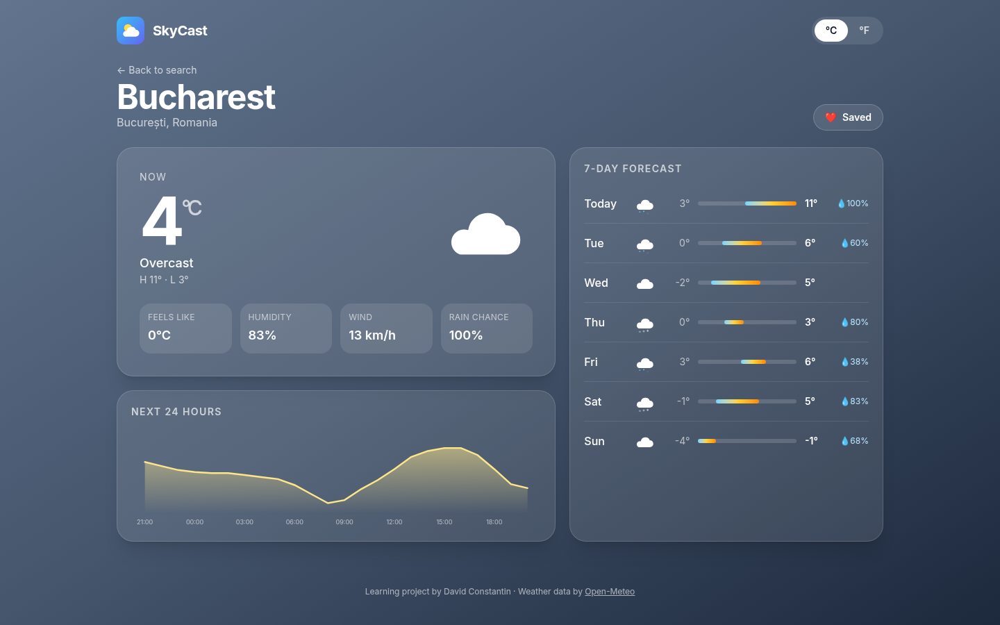
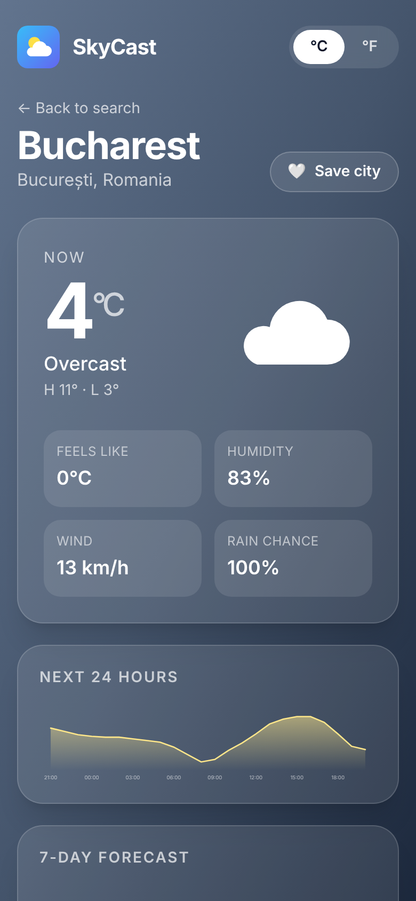
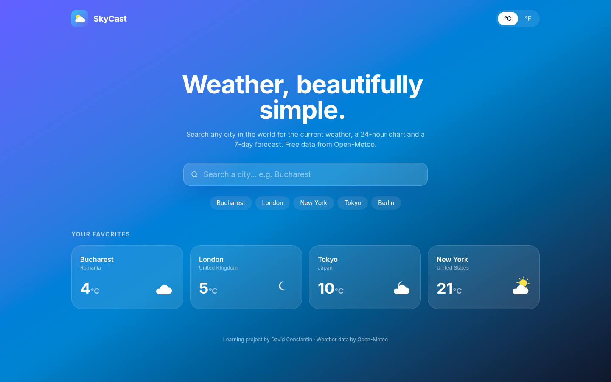

# SkyCast – Weather Explorer

A fast, animated weather app built with **React 19 + TypeScript**, **TanStack Query**, **React Router** and **Motion** (Framer Motion).
Search any city in the world and see the current weather, a 24-hour temperature chart and a 7-day forecast. Data comes from the free [Open-Meteo](https://open-meteo.com/) API (no API key needed).

> Learning project #2 in my React roadmap. It is a demo, not a commercial product.

**Live demo:** https://davidgeorgeconstantin-spec.github.io/skycast/

| Desktop | Mobile |
|---|---|
|  |  |



## Features

- 🔎 City autocomplete with **debounced** search, keyboard navigation (↑ ↓ Enter Esc) and ARIA combobox roles
- 🌤️ Current weather, feels-like, humidity, wind and rain chance
- 📈 Hand-made **SVG chart** for the next 24 hours (the line draws itself, hover/touch for details)
- 📅 7-day forecast with animated min–max temperature bars
- ❤️ Favorite cities saved in `localStorage`, each with live mini-forecast
- 🌡️ °C / °F switch (global setting via React Context)
- ⏳ Skeleton loaders, friendly error state with retry, request cancellation (`AbortSignal`)
- 🔗 Shareable URLs: all city data lives in the route (`#/city/:lat/:lon?name=…`)

### Animations (Motion)

- Page transitions with `AnimatePresence mode="wait"` (fade + slide + blur)
- Word-by-word staggered hero title, staggered lists and stat tiles
- Shared **layout animations** (`layoutId`) for the °C/°F pill and the search highlight
- Animated SVG weather icons (spinning sun, drifting cloud, falling rain/snow, lightning)
- Count-up temperature (`useMotionValue` + `animate`), heart "burst" micro-interaction
- Weather-based background gradient that cross-fades between conditions
- Respects **`prefers-reduced-motion`** (`<MotionConfig reducedMotion="user">` + `useReducedMotion`)

## Tech stack

| Area | Tools |
|---|---|
| UI | React 19, TypeScript (strict) |
| Data fetching | TanStack Query v5 (cache, retries, stale time) |
| Routing | React Router v7 (`HashRouter`, works on GitHub Pages) |
| Styling | Tailwind CSS v4 |
| Animation | Motion (`motion/react`) |
| Tooling | Vite, ESLint (typescript-eslint, react-hooks) |
| Deploy | GitHub Actions → GitHub Pages |

## Project structure

```
src/
├── main.tsx                     # providers: React Query, settings, router
├── App.tsx                      # routes + page transitions
├── components/
│   ├── layout/                  # Header, PageTransition, WeatherBackground
│   └── ui/                      # GlassCard, Skeleton, ErrorState, AnimatedNumber
├── features/
│   ├── search/CitySearch.tsx    # accessible autocomplete
│   ├── weather/                 # CurrentWeatherCard, HourlyChart, ForecastList, WeatherIcon
│   ├── favorites/               # FavoritesGrid, FavoriteCard, FavoriteButton
│   └── settings/                # SettingsContext (units + favorites)
├── hooks/                       # useCitySearch, useForecast, useDebounce, useLocalStorage
├── lib/                         # api.ts, weatherCodes.ts, format.ts, motion.ts, routes.ts
├── pages/                       # HomePage, CityPage, NotFoundPage
└── types/weather.ts             # shared TypeScript types
```

## Getting started

```bash
npm install
npm run dev      # http://localhost:5173
npm run lint
npm run build    # type-check + production build into dist/
```

## Deployment

`.github/workflows/deploy.yml` builds the app and publishes `dist/` to GitHub Pages on every push to `main`
(Settings → Pages → Source: **GitHub Actions**).

## Author

**David Constantin**, junior web developer · [Portfolio](https://davidgeorgeconstantin-spec.github.io/) · [GitHub](https://github.com/davidgeorgeconstantin-spec)
